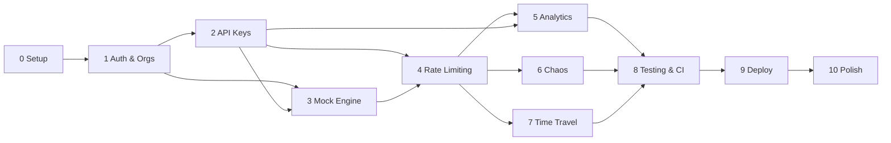

# API Developer Portal — Phase Breakdown

Companion to `API_DEVELOPER_PORTAL_PLAN.md`. This file is the _execution view_: what each phase delivers, what it depends on, how it's verified, and what can run in parallel.

---

## Phase Map

---

## Track A — Shippable Core (target: day ~35)

### Phase 0 — Foundation · Days 1–2

|                   |                                                                                                                                                                                                                                          |
| ----------------- | ---------------------------------------------------------------------------------------------------------------------------------------------------------------------------------------------------------------------------------------- |
| **Deliverables**  | pnpm/turbo monorepo (`apps/server`, `apps/web`, `packages/shared`), strict TS config, ESLint+Prettier+husky, docker-compose (TimescaleDB + Redis), Fastify `/health`, Next.js landing, Zod env validation, green GitHub Actions skeleton |
| **Deps**          | —                                                                                                                                                                                                                                        |
| **Exit criteria** | `pnpm dev` runs both apps; containers healthy; CI green on day one                                                                                                                                                                       |
| **Risk**          | Low                                                                                                                                                                                                                                      |

### Phase 1 — Auth & Organizations · Days 3–5

|                   |                                                                                                                                                                                                                             |
| ----------------- | --------------------------------------------------------------------------------------------------------------------------------------------------------------------------------------------------------------------------- |
| **Deliverables**  | Argon2id password auth, Redis-backed sessions in httpOnly cookies, CSRF double-submit tokens, `/dashboard/*` protected, `users`/`sessions`/`orgs`/`org_members` schema, `requireAuth()` + `requireRole()` permission matrix |
| **Deps**          | Phase 0                                                                                                                                                                                                                     |
| **Exit criteria** | Register → login → org auto-created → `GET /me` returns org + role; tampered cookie rejected                                                                                                                                |
| **Risk**          | Medium (was Low) — session security is the real work now; skip email verification/reset to stay in budget                                                                                                                   |
| **Parallel**      | Frontend layout/shell can be built while backend schema lands                                                                                                                                                               |

### Phase 2 — API Key Management · Days 6–9 ✅

|                   |                                                                                                                                                                                                                                                                                                                                                     |
| ----------------- | --------------------------------------------------------------------------------------------------------------------------------------------------------------------------------------------------------------------------------------------------------------------------------------------------------------------------------------------------- |
| **Deliverables**  | `api_keys` / `api_key_families` / `api_key_events` schema, `sk_{env}_{publicId}_{secret}` generation, HMAC-SHA-256 pepper hashing, prefix + last4, indexed `public_id` lookup path, async `last_used_at` write-behind buffer, rotation with 24h grace, family revocation (kill switch), scopes, idempotency on create, Keys UI with one-time reveal |
| **Deps**          | Phase 1                                                                                                                                                                                                                                                                                                                                             |
| **Exit criteria** | curl a protected endpoint with the key → revoke → 401; rotation overlap works                                                                                                                                                                                                                                                                       |
| **Risk**          | Medium — the lookup path is the hottest code in the project; get the cache invalidation right                                                                                                                                                                                                                                                       |
| **Notes**         | One deliberate divergence from the original plan: keys use HMAC-SHA-256 with a server-side pepper rather than Argon2id. A slow KDF is wrong for a 192-bit secret — there is nothing to brute force — and it would have added 50–100ms to every request, blowing the p95 budget in Phase 4. See `API_KEY_MANAGEMENT_PLAN.md`.                        |
| **Done**          | 2026-10-20 — 77 tests (unit + Postgres integration + HTTP routes), including all 9 documented failure modes                                                                                                                                                                                                                                         |

### Phase 3 — Mock API Engine · Days 10–14

|                   |                                                                                                                                                                                                                                                     |
| ----------------- | --------------------------------------------------------------------------------------------------------------------------------------------------------------------------------------------------------------------------------------------------- |
| **Deliverables**  | `mock_services` / `mock_routes` schema, radix-tree router (`find-my-way`), template renderer (`{{params.*}}`, `{{query.*}}`, seeded `{{faker.*}}`), flagship E-commerce service, CRUD UI with live preview, OpenAPI 3.1 generation + Stoplight docs |
| **Deps**          | Phase 2 (keys gate the mock endpoints)                                                                                                                                                                                                              |
| **Exit criteria** | Authenticated templated JSON response; docs render                                                                                                                                                                                                  |
| **Risk**          | Medium — template sandboxing; keep it declarative (no `eval`)                                                                                                                                                                                       |

### Phase 4 — Rate Limiting · Days 15–20 ⭐

|                   |                                                                                                                                                                                                                            |
| ----------------- | -------------------------------------------------------------------------------------------------------------------------------------------------------------------------------------------------------------------------- |
| **Deliverables**  | `plans` table, atomic Redis Lua sliding window, ordered middleware pipeline (auth → org → tier → limit → quota → chaos → handler), `X-RateLimit-*` + `Retry-After` on 200s _and_ 429s, pub/sub tier invalidation, k6 proof |
| **Deps**          | Phases 2, 3                                                                                                                                                                                                                |
| **Exit criteria** | k6: exact limit enforcement, correct headers, <5ms p95 overhead; plan upgrade takes effect without restart                                                                                                                 |
| **Risk**          | High — the flagship technical feature; get exact-boundary tests in from day one                                                                                                                                            |
| **Parallel**      | k6 script can be drafted during Phase 3                                                                                                                                                                                    |

### Phase 5 — Analytics & TimescaleDB · Days 21–27 ⭐

|                   |                                                                                                                                                                                                                                                      |
| ----------------- | ---------------------------------------------------------------------------------------------------------------------------------------------------------------------------------------------------------------------------------------------------- |
| **Deliverables**  | `request_logs` hypertable + indexes, non-blocking batched ingestion (500ms / 100 rows), continuous aggregate for hourly p95, analytics endpoints (usage/latency/errors), Recharts dashboard, signed HMAC quota webhooks at 80%/100% via BullMQ + DLQ |
| **Deps**          | Phase 4 (needs `rate_limited`, `key_id`, latency data flowing)                                                                                                                                                                                       |
| **Exit criteria** | Traffic → charts populate from aggregates; webhook fires at 80%; p95 flat at 1M rows                                                                                                                                                                 |
| **Risk**          | High — backpressure and insert batching; the de-facto postmortem story                                                                                                                                                                               |

### Phase 9 — Deployment · Days 45–48 (pulled forward for MVP)

|                   |                                                                                                                                                                                                                                             |
| ----------------- | ------------------------------------------------------------------------------------------------------------------------------------------------------------------------------------------------------------------------------------------- |
| **Deliverables**  | Dockerfile (multi-stage, non-root, healthcheck), API on Fly.io/Railway, Upstash + Neon/Supabase, frontend on Vercel, CORS lockdown, separate dashboard-API limiter, pino + Sentry, CI secret scanning, seeded demo org with 30 days of data |
| **Exit criteria** | Clean browser → live URL works end-to-end; demo dashboard looks alive                                                                                                                                                                       |

### Phase 10 — Portfolio Polish · Days 49–56 (MVP-complete)

|                   |                                                                                                                                       |
| ----------------- | ------------------------------------------------------------------------------------------------------------------------------------- |
| **Deliverables**  | README with pitch + GIF + Mermaid architecture, 4 ADRs, one postmortem, 3-min demo video, optional blog post on the Redis Lua limiter |
| **Exit criteria** | A stranger can run and evaluate it in <10 minutes                                                                                     |

---

## Track B — Differentiators (adds ~12 days)

### Phase 6 — Chaos Engineering Controls · Days 28–32 🎯

|                   |                                                                                                                                                                                                   |
| ----------------- | ------------------------------------------------------------------------------------------------------------------------------------------------------------------------------------------------- |
| **Deliverables**  | Per-key chaos config in Redis, middleware injecting sampled latency / 5xx / 429 / socket drops, dashboard sliders (5s read-through cache), self-demonstrating resilience test page with histogram |
| **Deps**          | Phase 4 pipeline (inserted before the route handler)                                                                                                                                              |
| **Exit criteria** | 5% error rate → ~5 failures per 100 requests, correct distribution                                                                                                                                |
| **Risk**          | Medium — the `weighted_responses` column in Phase 3 exists for this                                                                                                                               |

### Phase 7 — Time-Travel Playground · Days 33–39 🎯

|                   |                                                                                                                                                                                                            |
| ----------------- | ---------------------------------------------------------------------------------------------------------------------------------------------------------------------------------------------------------- |
| **Deliverables**  | `playground_sessions` / `playground_requests` capture, in-app request runner (Monaco) reusing the real pipeline, replay + fork, JSON deep-diff side-by-side, export to Vitest snapshot / OpenAPI / Postman |
| **Deps**          | Phases 3, 5, 6                                                                                                                                                                                             |
| **Exit criteria** | Send → toggle chaos → replay → diff → exported test passes locally                                                                                                                                         |
| **Risk**          | High — the largest surface area; ship 7.1–7.4 first, treat 7.5 as the bonus                                                                                                                                |

### Phase 8 — Testing & CI Hardening · Days 40–44

|                   |                                                                                                                                                                      |
| ----------------- | -------------------------------------------------------------------------------------------------------------------------------------------------------------------- |
| **Deliverables**  | Vitest units (limiter boundaries, renderer, key auth), Supertest integration against real Redis via testcontainers, Playwright E2E, full CI matrix, nightly k6 smoke |
| **Deps**          | All feature phases                                                                                                                                                   |
| **Exit criteria** | >80% coverage on limiter/auth/template; red test blocks merge                                                                                                        |
| **Note**          | Written tests are _not_ deferred to the end — this phase consolidates what each phase adds as it goes                                                                |

---

## Dependency-Ordered Checklist

- [x] P0 Foundation
- [x] P1 Auth & Orgs
- [x] P2 API Keys
- [ ] P3 Mock Engine
- [ ] P4 Rate Limiting ⭐
- [ ] P5 Analytics ⭐
- [ ] P6 Chaos 🎯
- [ ] P7 Time Travel 🎯
- [ ] P8 Testing & CI
- [ ] P9 Deployment
- [ ] P10 Polish

## Milestones

| Milestone |   Phase    |  Day   | Meaning                                          |
| --------- | :--------: | :----: | ------------------------------------------------ |
| M1        |     0      |   2    | Infra runs, CI green                             |
| M2        |     2      |   9    | A key exists and gates a real endpoint           |
| M3        |     4      |   20   | Rate limiting is provably correct under load     |
| M4        |     5      |   27   | Dashboard is data-driven and fast at scale       |
| M5        |     7      |   39   | Differentiators complete — complexity target met |
| **MVP**   | 0–5, 9, 10 | ~35–40 | Shippable portfolio piece                        |
| **Final** |   8, 10    |   56   | Interview-ready                                  |

## Suggested Sequencing Rules

1. **Never defer a test.** Each phase ships with its own unit tests; Phase 8 is a consolidation + coverage push, not a catch-up.
2. **P4 is the ceiling.** If the sliding-window limiter isn't airtight (exact boundaries, concurrent bursts, window expiry), don't start P5 — everything downstream is noise.
3. **Ship Track A before Track B.** A working rate-limited mock API with analytics beats a half-built chaos playground.
4. **One commit-sized story per step.** Each numbered step in the plan should land as a PR with a green pipeline.
