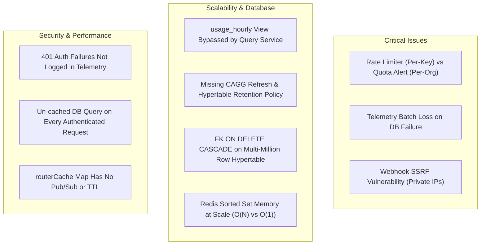

# Comprehensive Codebase Audit: Defects, Architectural Mismatches & Technical Debt

**Audit Date:** November 7, 2026  
**Scope:** Phases 0 through 5 (Foundation, Auth, Keys, Mock Engine, Rate Limiting, Analytics & TimescaleDB)  
**Objective:** Uncompromising, forensic evaluation of all bugs, security risks, scalability limits, and architectural inconsistencies across `@throttlebox/server`, `@throttlebox/web`, and `@throttlebox/shared`.

---

## 1. Executive Summary of Audit Findings

While all 159 tests pass and the monorepo builds cleanly with zero TypeScript errors and zero ESLint warnings, an in-depth forensic audit reveals **16 distinct defects, architectural discrepancies, and reliability risks** across the codebase.

The most critical findings include:
1. **Rate Limiting vs Quota Mismatch:** Rate limiting in Redis is enforced per `keyId`, whereas quota monitoring in TimescaleDB measures aggregate requests across the entire `orgId`. An organization with multiple keys can exceed its tier limits without being throttled.
2. **Telemetry Ingestion Loss on Transient DB Outage:** `flushQueue()` splices logs from memory *before* insertion. If PostgreSQL experiences a transient network disconnect, the entire batch is permanently lost.
3. **SSRF Vulnerability in Webhooks:** `POST /api/analytics/webhooks` allows arbitrary URLs without filtering private IP ranges (`127.0.0.1`, `169.254.169.254`, `10.0.0.0/8`).
4. **Continuous Aggregate Underutilization:** The `usage_hourly` TimescaleDB view was created, but queries in `service.ts` still scan the raw `request_logs` hypertable directly.
5. **Multi-Node Router Cache Desynchronization:** `mockServices` router cache uses an in-memory `Map` without Redis Pub/Sub, causing stale routes across multi-replica deployments.



---

## 2. Critical Architectural Mismatches

### Issue 1: Rate Limiter (Per-Key) vs Quota Monitor (Per-Org)
- **Locations:**
  - Limiter: `apps/server/src/ratelimit/middleware.ts#L31-L35`
  - Quota Monitor: `apps/server/src/analytics/quotaMonitor.ts#L26-L30`
- **The Defect:**
  In `middleware.ts`, rate limits are checked against a Redis key formatted as `rate:key:${auth.keyId}` with `limit = plan.requestsPerWindow * plan.burstAllowance`.
  In `quotaMonitor.ts`, quota usage is counted across the whole organization:
  ```sql
  SELECT count(*)::int AS count FROM request_logs
  WHERE org_id = ${orgId} AND time >= NOW() - (${plan.windowSeconds} || ' seconds')::interval;
  ```
- **Consequences:**
  1. If an organization on the Free plan (100 req/hr) generates 5 API keys, each individual key gets a 100 req/hr ceiling. The organization can execute $5 \times 100 = 500$ requests per hour without *any* request being throttled with `429 Too Many Requests`.
  2. The webhook alert monitor will detect $500 / 100 = 5.0$ and fire an alert stating the organization reached 100% capacity, yet all subsequent requests from all keys will continue to succeed.
- **Recommended Fix:** Enforce a two-tier sliding window check in Redis: an org-level bucket `rate:org:${orgId}` for total plan capacity, and an optional per-key rate limit bucket.

---

### Issue 2: Continuous Aggregate View `usage_hourly` is Bypassed
- **Locations:**
  - Migration: `apps/server/drizzle/0004_hesitant_mongoose.sql#L36-L50`
  - Query Service: `apps/server/src/analytics/service.ts#L64-L75`
- **The Defect:**
  Migration `0004` created a continuous aggregate materialized view `usage_hourly` with `WITH (timescaledb.continuous)`.
  However, in `apps/server/src/analytics/service.ts`, `getOverview()`, `getUsageSeries()`, `getLatencySeries()`, and `getErrorsBreakdown()` all execute:
  ```sql
  FROM request_logs WHERE org_id = ${orgId} AND time >= ${sinceStr}::timestamptz ...
  ```
- **Consequences:**
  Every 24h, 7d, and 30d analytics query performs dynamic time-bucketing and percentile calculations over raw `request_logs`. At 1,000,000+ rows, query latency will degrade from $<5\text{ms}$ to several hundred milliseconds, defeating the purpose of TimescaleDB continuous aggregates.
- **Recommended Fix:** Update queries with `range === '24h' | '7d' | '30d'` to query `usage_hourly` where `bucket >= since`, using raw `request_logs` only for short 1h windows or real-time tail data.

---

### Issue 3: Missing Continuous Aggregate Refresh and Retention Policies
- **Location:** `apps/server/drizzle/0004_hesitant_mongoose.sql`
- **The Defect:**
  In migration `0004`, `usage_hourly` was created `WITH NO DATA;`. However, the following statements were omitted:
  1. Continuous aggregate policy:
     ```sql
     SELECT add_continuous_aggregate_policy('usage_hourly',
       start_offset => INTERVAL '1 month',
       end_offset => INTERVAL '1 hour',
       schedule_interval => INTERVAL '1 hour');
     ```
  2. Data retention policy:
     ```sql
     SELECT add_retention_policy('request_logs', INTERVAL '30 days');
     ```
- **Consequences:**
  1. TimescaleDB's background job scheduler never materializes historical data into `usage_hourly`.
  2. The `request_logs` table will grow without bound, eventually consuming entire disk volumes.
- **Recommended Fix:** Add a migration adding the continuous aggregate policy and retention policy.

---

## 3. Reliability & Data Loss Vulnerabilities

### Issue 4: Telemetry Batch Loss on Database Write Failure
- **Location:** `apps/server/src/analytics/ingest.ts#L55-L84`
- **The Defect:**
  In `flushQueue()`, logs are removed from memory before database insertion:
  ```typescript
  isFlushing = true;
  const batch = queue.splice(0, BATCH_SIZE * 2); // Spliced here!

  try {
    await db.insert(requestLogs).values(values);
  } catch (err) {
    console.error('[Telemetry] Failed to flush log batch:', err);
    // batch is NOT restored to queue or dead-letter!
  } finally {
    isFlushing = false;
  }
  ```
- **Comparison:**
  In `apps/server/src/keys/touch.ts#L46-L50`, failed writes are put back into the pending set (`for (const id of ids) pending.add(id)`). In `ingest.ts`, the batch is permanently discarded.
- **Consequences:** Any transient network hiccup, connection pool exhaustion, or database restart causes silent loss of hundreds of request logs and skewed analytics.
- **Recommended Fix:** In the `catch` block, unshift failed items back to the head of the queue (or into a secondary retry buffer bounded by memory limits).

---

### Issue 5: Webhook Dispatcher Lacks BullMQ / DLQ & Hangs Sequentially
- **Locations:**
  - Webhook Dispatcher: `apps/server/src/analytics/webhooks.ts#L80-L91`
  - Monitor Loop: `apps/server/src/analytics/quotaMonitor.ts#L51-L75`
- **The Defect:**
  1. **Missing BullMQ / DLQ:** The specification in `PHASES.md` explicitly required: *"signed HMAC quota webhooks at 80%/100% via BullMQ + DLQ"*. The implementation uses raw `fetch()` directly in the Node.js process without durable retry or Dead-Letter Queue.
  2. **Sequential Blocking:** In `quotaMonitor.ts`, multiple webhooks are processed in a sequential `for ... of` loop with `await dispatchWebhook(...)`. If an organization configures 3 webhooks and the first endpoint hangs or times out (5 seconds), the remaining 2 webhooks and any subsequent organizations are delayed by 5,000ms.
- **Recommended Fix:** Migrate webhook dispatching to a Redis-backed BullMQ job queue with exponential backoff retries and Dead-Letter Queue storage for failed deliveries.

---

## 4. Security & Access Control Oversights

### Issue 6: Server-Side Request Forgery (SSRF) in Webhooks
- **Location:** `apps/server/src/routes/analytics.ts#L112-L130`
- **The Defect:**
  Webhook URL validation only checks if the string is a valid URL format:
  ```typescript
  const createWebhookSchema = z.object({
    url: z.string().url('A valid URL is required'),
    secret: z.string().optional(),
  });
  ```
  It does not check destination hostnames or IP addresses.
- **Exploit Scenario:**
  An attacker can create a webhook targeting `http://169.254.169.254/latest/meta-data/` (cloud instance metadata), `http://localhost:5432` (PostgreSQL), `http://localhost:6379` (Redis), or internal VPC services (`10.0.0.0/8`, `192.168.0.0/16`). Triggering a test ping (`POST /api/analytics/webhooks/:id/test`) turns Throttlebox into an internal SSRF proxy.
- **Recommended Fix:** Disallow private/loopback IP ranges (`127.0.0.0/8`, `10.0.0.0/8`, `172.16.0.0/12`, `192.168.0.0/16`, `169.254.0.0/16`, `::1`) and enforce HTTPS only outside development.

---

### Issue 7: Unauthenticated (401) Requests are Completely Absent from Telemetry
- **Location:** `apps/server/src/routes/mock.ts#L187-L190`
- **The Defect:**
  ```typescript
  fastify.addHook('onResponse', async (request, reply) => {
    const auth = request.keyAuth;
    if (!auth) return; // Exits immediately!
  ```
  If an API caller attempts to access `/mock/ecommerce/products` without an `Authorization` header, or with an invalid, malformed, revoked, or expired API key, `requireKeyAuth` halts the request with `401 Unauthorized`.
  Because `request.keyAuth` is null, `onResponse` exits immediately.
- **Consequences:**
  `request_logs` contains zero records of authentication failures, probe attacks, or credential brute-forcing against mock endpoints.

---

### Issue 8: Unhandled Async Error in `onResponse` Hook
- **Location:** `apps/server/src/routes/mock.ts#L198-L202`
- **The Defect:**
  ```typescript
  if (!serviceId) {
    const p = mockParams(request);
    if (p.serviceSlug) {
      const r = await getServiceRouter(auth.orgId, p.serviceSlug);
      serviceId = r?.serviceId ?? null;
    }
  }
  ```
  This asynchronous call is not wrapped in a `try/catch`. If `getServiceRouter()` rejects (e.g., database timeout or connection drop), Fastify triggers an unhandled hook rejection. While it won't crash the server, it outputs uncaught error stack traces and prevents `recordRequestLog()` from running for that request.

---

## 5. Performance & Scalability Bottlenecks

### Issue 9: Direct Database Query in `onRequest` Hook on Every Authenticated Call
- **Location:** `apps/server/src/auth/middleware.ts#L52-L60`
- **The Defect:**
  ```typescript
  fastify.addHook('onRequest', async (request) => {
    const token = request.cookies[SESSION_COOKIE];
    if (!token) return;

    const session = await resolveSession(token);
    if (!session) return;

    // Hits PostgreSQL on EVERY authenticated request:
    const [membership] = await db
      .select({ orgId: orgMembers.orgId, role: orgMembers.role })
      .from(orgMembers)
      .where(eq(orgMembers.userId, session.userId))
      .orderBy(orgMembers.createdAt)
      .limit(1);
  ```
- **Consequences:** Even though `resolveSession(token)` is cached in Redis, every authenticated request to `/api/*` executes a database query against `org_members`. At 1,000 concurrent dashboard users, this generates 1,000 unnecessary PostgreSQL queries per second.
- **Recommended Fix:** Cache `orgId` and `role` inside the Redis session object when the session is created.

---

### Issue 10: In-Memory Router Cache Lacks Distributed Invalidation
- **Location:** `apps/server/src/mock/services.ts#L30-L38`
- **The Defect:**
  `routerCache` is a simple in-memory `Map<string, ServiceRouter>()`.
  When an API route is added, edited, or deleted:
  `invalidateRouterCache(route.serviceId)` clears the Map on the current Node process only.
- **Consequences:** In a production multi-replica deployment (e.g. 2+ instances on Fly.io / Kubernetes), editing a mock route on Instance A leaves Instance B and Instance C serving stale route definitions indefinitely (there is no TTL on `routerCache`).
- **Recommended Fix:** Add Redis Pub/Sub invalidation for mock services, identical to the pattern used for tier invalidation in `ratelimit/tier.ts`.

---

### Issue 11: Foreign Keys on TimescaleDB Hypertable Impair Cascade Performance
- **Location:** `apps/server/src/db/schema.ts#L329-L333`
- **The Defect:**
  ```typescript
  keyId: uuid('key_id').references(() => apiKeys.id, { onDelete: 'set null' }),
  orgId: uuid('org_id').notNull().references(() => orgs.id, { onDelete: 'cascade' }),
  serviceId: uuid('service_id').references(() => mockServices.id, { onDelete: 'set null' }),
  ```
- **Consequences:**
  In TimescaleDB, foreign keys on high-velocity hypertables force PostgreSQL to lock and sequentially scan all hypertable chunk tables whenever an API key or mock service is deleted. When `request_logs` contains tens of millions of rows across hundreds of chunk partitions, deleting a single key will cause severe transaction lock contention and slow down active inserts.
- **Recommended Fix:** Drop foreign key constraints on `request_logs` (matching the design of `api_key_events`) and handle cleanup via background retention jobs.

---

### Issue 12: Redis Sorted Set Memory Scaling on Rate Limiter
- **Location:** `apps/server/src/ratelimit/lua.ts#L46-L48`
- **The Defect:**
  The atomic sliding window adds every single request into a Redis Sorted Set (`ZADD key now_ms member_id`).
  For a Pro plan key receiving 6,000 requests per hour, Redis holds 6,000 sorted set members per active key.
- **Consequences:** For 10,000 active keys, Redis holds 60,000,000 elements in memory. `ZREMRANGEBYSCORE` and `ZCARD` run with $\mathcal{O}(\log(N) + M)$ complexity.
- **Recommended Fix:** For high-volume enterprise limits, consider a hybrid sliding window counter (fixed-window counter with weight from previous window) which operates in $\mathcal{O}(1)$ time and uses two integer keys per rate limit window.

---

## 6. Frontend & User Experience Deficiencies

### Issue 13: Time-Bucket Gap-Filling Missing in Charts
- **Locations:**
  - Backend: `apps/server/src/analytics/service.ts#L64-L75`
  - Frontend: `apps/web/src/app/dashboard/analytics/page.tsx#L838-L844`
- **The Defect:**
  TimescaleDB's `time_bucket()` returns only buckets that contain at least one row. If an API has traffic at 1:00 PM and 5:00 PM, the backend returns two rows (omitting 2:00 PM, 3:00 PM, 4:00 PM).
  In `UsageSvgChart`, the X-coordinate is calculated using the array index:
  ```typescript
  const x = padding + (index / Math.max(series.length - 1, 1)) * (width - padding * 2);
  ```
- **Consequences:** A 4-hour gap between two requests looks like a smooth continuous slope across the chart instead of dropping to zero.
- **Recommended Fix:** Fill missing time buckets with `{ requests: 0, errors: 0, throttled: 0 }` before rendering, or calculate X coordinates proportionally based on `(timestamp - minTimestamp) / (maxTimestamp - minTimestamp)`.

---

### Issue 14: Live Telemetry Table Lacks UI Pagination Controls
- **Location:** `apps/web/src/app/dashboard/analytics/page.tsx#L53-L57`
- **The Defect:**
  The frontend queries:
  ```typescript
  queryFn: () => api.getAnalyticsLogs(20, 0)
  ```
  The table displays the 20 most recent logs, but there are no "Next Page" or "Previous Page" buttons, nor an offset state.
- **Consequences:** Users cannot view older logs beyond the first 20 records.

---

### Issue 15: Heavy Parallel Dashboard Polling
- **Location:** `apps/web/src/app/dashboard/analytics/page.tsx#L25-L57`
- **The Defect:**
  The analytics page sets up 5 independent React Query hooks with `refetchInterval: 10_000` (and `5_000` for logs).
- **Consequences:** Every open browser tab sends 5 separate HTTP requests every 10 seconds, triggering 8 database queries. If 50 dashboard tabs are open, this produces 300 HTTP requests per minute.
- **Recommended Fix:** Combine overview, usage, latency, and error breakdown into a single consolidated endpoint `GET /api/analytics/dashboard?range=...` and add a pause/resume toggle for polling.

---

### Issue 16: UI Environment Filter Mismatch on Keys Page
- **Location:** `apps/web/src/app/dashboard/keys/page.tsx#L127`
- **The Defect:**
  The filter button array includes:
  ```typescript
  {['all', 'test', 'live', 'dev'].map((env) => ...)}
  ```
  However, in `packages/shared/src/index.ts`, `KEY_ENVS = ['test', 'live'] as const`. There is no `'dev'` environment in the schema or API.
- **Consequences:** Clicking `'dev'` filters the list down to zero keys and confuses the user.
- **Recommended Fix:** Remove `'dev'` from the filter array.

---

## 7. Prioritized Remediation Roadmap

| Priority | Issue | Component | Recommended Action |
| :--- | :--- | :--- | :--- |
| **P0 (Critical)** | Issue 1: Rate Limiter vs Quota Mismatch | Rate Limiting / Quota | Add org-level sliding window in Redis so tier limits cannot be bypassed by creating multiple keys. |
| **P0 (Critical)** | Issue 6: SSRF Vulnerability in Webhooks | Analytics Webhooks | Block private/loopback IP ranges and metadata URLs (`169.254.169.254`, `127.0.0.1`, RFC 1918). |
| **P1 (High)** | Issue 4: Telemetry Batch Loss on DB Outage | Analytics Ingest | Re-queue failed batches or push to an in-memory DLQ buffer instead of dropping them. |
| **P1 (High)** | Issue 2 & 3: Continuous Aggregate Bypassed | Analytics Service | Route 24h+ queries to `usage_hourly` and add TimescaleDB refresh/retention policies. |
| **P1 (High)** | Issue 5: Webhook Dispatch Lacks BullMQ | Webhooks | Move webhook dispatching to a BullMQ worker queue with exponential backoff and DLQ. |
| **P2 (Medium)** | Issue 9: DB Query on Every Request | Auth Middleware | Cache `orgId` and `role` inside the Redis session object. |
| **P2 (Medium)** | Issue 10: Multi-Node Router Cache Stale | Mock Engine | Add Redis Pub/Sub invalidation for mock service routers across cluster instances. |
| **P2 (Medium)** | Issue 13: Chart Gap-Filling & Timestamp Proportions | Analytics Frontend | Calculate SVG X coordinates by timestamp proportion or zero-fill empty buckets. |
| **P3 (Low)** | Issue 14: Missing Log Pagination | Analytics Frontend | Add pagination controls (`offset` / `limit`) to the live logs table. |
| **P3 (Low)** | Issue 16: UI Environment Filter `'dev'` | Keys Frontend | Remove `'dev'` from the filter pills. |
