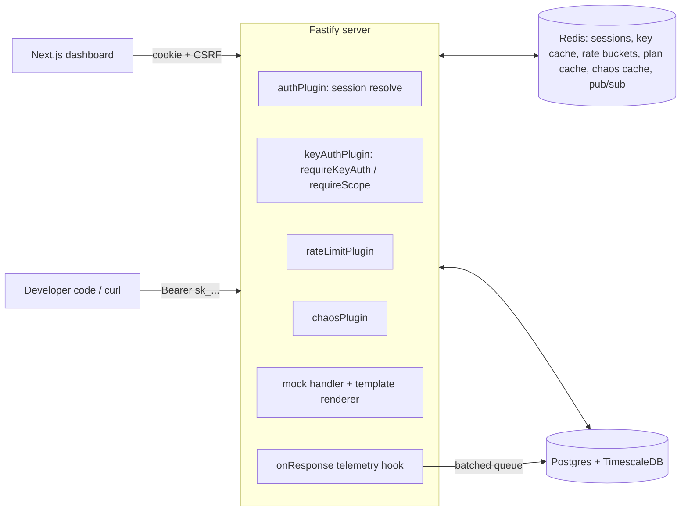

# Architecture

## Monorepo layout

```
throttlebox/
├── apps/
│   ├── server/            @throttlebox/server — Fastify API (port 3001)
│   │   ├── src/
│   │   │   ├── index.ts           buildServer() + main(), lifecycle & shutdown
│   │   │   ├── config.ts          zod env validation (fails fast)
│   │   │   ├── auth/              session, password, CSRF, janitor, authPlugin
│   │   │   ├── keys/              key format/generate/verify/store/cache/touch/audit/redact
│   │   │   ├── ratelimit/         Lua script, limiter, tier (plan) cache, middleware
│   │   │   ├── chaos/             rule cache (resolve hierarchy), sampling math, middleware
│   │   │   ├── mock/              template engine, seed, service router cache, openapi, default services
│   │   │   ├── analytics/         ingest buffer, query service, webhooks, quota monitor
│   │   │   ├── routes/            auth, keys, services, org, analytics, chaos, mock, openapi
│   │   │   ├── http/              error handler, health, security headers, content-type, auth limiter
│   │   │   ├── db/                drizzle client, redis client, schema
│   │   │   └── util/crypto.ts     constant-time compare
│   │   ├── drizzle/               SQL migrations 0000–0006 + meta
│   │   └── tests/                 vitest suites (+ k6 perf script)
│   └── web/               @throttlebox/web — Next.js app (port 3000)
│       └── src/app/       /, /login, /docs, /dashboard/{keys,services,rate-limits,analytics,chaos,docs}
├── packages/shared/       @throttlebox/shared — roles/permissions, plans, API contract types
├── docker-compose.yml     TimescaleDB (pg16) + Redis 7
├── turbo.json, pnpm-workspace.yaml, tsconfig.base.json, eslint.config.js
└── .github/workflows/ci.yml
```

Next.js is a **pure client**: all data goes through the Fastify service (`apps/web/src/lib/api.ts` uses `credentials: 'include'` and echoes the CSRF cookie in `X-CSRF-Token`). The shared package gives both sides the same request/response types and the plan table.

## Runtime components



## Public mock request pipeline

`ALL /mock/:serviceSlug/*` (GET needs `mock:read`; POST/PUT/PATCH/DELETE need `mock:write`):

1. `requireKeyAuth` — parse bearer header only (never query string), `verifyKey` → `request.keyAuth` (`orgId`, `keyId`, scopes). Every failure mode yields the same 401 body.
2. `requireScope` — 403 if the key lacks the scope.
3. `rateLimitMock` — resolve org plan (memory 30 s → Redis 60 s → Postgres), run Lua sliding window on `rate:org:<orgId>`, set `X-RateLimit-*`; 429 + `Retry-After` when exceeded. **Fails open** if Redis errors.
4. `chaosEngine` — resolve service from slug, resolve most specific chaos rule, then in order: socket drop → latency delay → error injection. Unknown service bypasses chaos so the handler returns a clean 404.
5. Handler — look up the service's `find-my-way` router (cached per org+slug), match route, render the JSON template with seeded faker, apply route headers/status/`latencyMs`.
6. `onResponse` hook — records `{keyId, orgId, serviceId, method, path, status, latency, rateLimited, traceId}` to the ingest queue (non-blocking). 401s are logged, not stored.

Dashboard preview (`POST /api/mock/preview`) uses the same renderer authenticated by session, so what the author sees is what callers get.

## Caches and cross-instance invalidation

| Data                 | Layers                                                          | Invalidation                                                                        |
| -------------------- | --------------------------------------------------------------- | ----------------------------------------------------------------------------------- |
| Session              | Redis (fast) + Postgres `sessions` (durable, hashed)            | Sliding TTL; janitor purges expired rows                                            |
| Org plan             | In-process 30 s → Redis 60 s → DB                               | Pub/sub channel `plan:changed` + explicit delete                                    |
| Mock service router  | In-process map                                                  | Pub/sub (`startRouterPubSub`)                                                       |
| Chaos rule           | In-process 5 s (max 1000 entries, FIFO evict) → Redis 60 s → DB | Pub/sub channel `chaos:invalidated`                                                 |
| API key verification | Redis cache                                                     | Explicit invalidation on revoke/rotate (audit item M7: no pub/sub for local copies) |

## Background workers (started in `main()`)

| Worker                                                       | Purpose                                                                                                    |
| ------------------------------------------------------------ | ---------------------------------------------------------------------------------------------------------- |
| `startTouchFlusher`                                          | Write-behind buffer for `api_keys.last_used_at`                                                            |
| `startSessionJanitor`                                        | Sweeps expired session rows                                                                                |
| `startTierPubSub` / `startRouterPubSub` / `startChaosPubSub` | Subscribe to invalidation channels (separate Redis connections)                                            |
| `startIngestFlusher`                                         | Flushes the telemetry queue every 500 ms or at 100 rows; queue cap 10 000 (drops oldest 10% on saturation) |
| `setQuotaCheckCallback(checkOrgQuotas)`                      | After each flush, checks touched orgs for 80/100% quota → webhooks                                         |

`SIGTERM`/`SIGINT` stop everything in order, flushing buffers before `fastify.close()`.

## Other server behaviour

- **Proxy trust**: `trustProxy` callback trusts `hop < TRUST_PROXY_HOPS`; with 0, `X-Forwarded-For` is ignored.
- **CORS**: origins from `WEB_ORIGIN` (comma-separated, default `http://localhost:3000`), credentials on.
- **Errors**: one central handler withholds internal messages outside development.
- **Content type**: lenient parser registered (`http/contentType.ts`).
- **Health**: `/health` (liveness, touches nothing) and `/health/ready` (checks Postgres and Redis, 503 otherwise).
- **Entry guard**: `main()` only runs when `process.argv[1]` includes `index`; tests import `buildServer()`.

## Design decisions worth knowing

- **Keys use HMAC-SHA-256 + pepper, not Argon2id** — keys carry ~192 bits of entropy; a slow KDF only adds 50–100 ms per request.
- **Org-level rate limiting** — the limiter bucket is `rate:org:<orgId>` so adding keys can't multiply the quota (an earlier per-key design was flagged in the debt audit and fixed).
- **Redis is a cache, Postgres is truth** — except rate-limit counters, which live only in Redis.
- **No `eval` anywhere in the template engine.**
- **Stable mock responses** — seed derived from org + service + request path, not from the credential.
